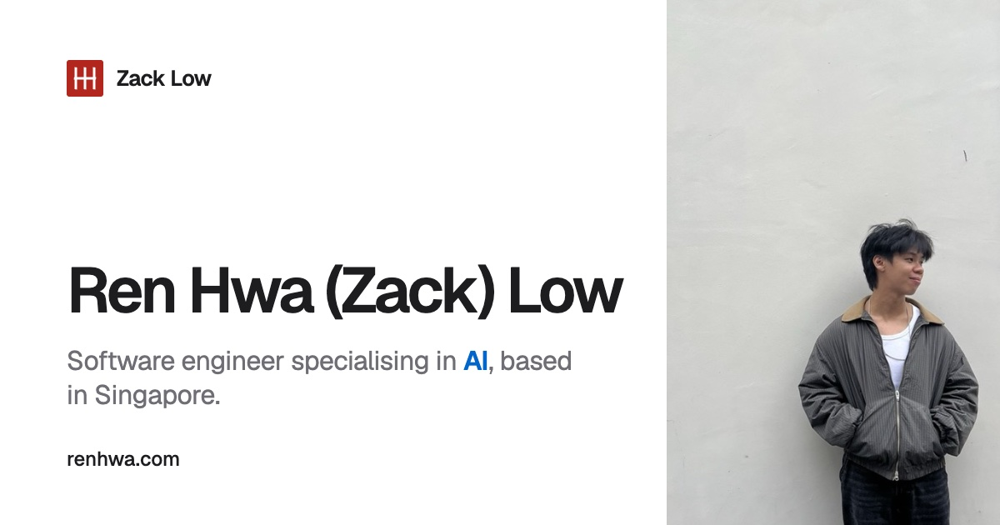

# renhwa.com

The personal site of Ren Hwa (Zack) Low: work case studies, projects, hobbies
and a CV. Live at [renhwa.com](https://renhwa.com).

[](https://renhwa.com)

A static [Astro](https://astro.build) site: MDX content collections, strict
TypeScript and plain CSS. No UI framework, no CSS framework and no CMS. The
only JavaScript is Astro's client router and a few small behaviour scripts
(theme, menu, search, contact, article media).

## Run locally

Use the Node version in `.nvmrc` (Astro needs 22.23.4 or newer) and the
committed lockfile.

```sh
nvm use
npm ci
npm run dev        # http://localhost:4321
npm run verify     # everything the deploy runs
```

No environment variables or external services are needed to build the site.

## Add content

Copy a template. The folder name becomes the URL.

```sh
cp -r src/content/_template/project src/content/projects/my-thing
# edit index.mdx, put its pictures beside it
npm run verify
```

| Type | Template | Goes in | URL |
| --- | --- | --- | --- |
| Project | `_template/project` | `src/content/projects/<slug>/` | `/projects/<slug>` |
| Role | `_template/work` | `src/content/work/<slug>/` | `/work/<slug>` |
| Hobby | `_template/hobby` | `src/content/hobbies/<slug>/` | `/hobbies/<slug>` |

[Adding content](docs/authoring.md) covers employers, pictures, technology
ids, publication flags and what to check. [MDX components](docs/mdx-components.md)
lists the article components (figures, photos, clips, charts, timelines,
flows, tables) and their props.

Read [Writing for this site](docs/writing.md) before you change any sentence,
especially [how he likes an article to read](docs/writing.md#how-he-likes-an-article-to-read).
Work bullets are verbatim from the CV, and reflections come from his own words.

## Structure

Only `src/pages/` is reserved by Astro. Everything else is a convention.

```text
src/
  pages/         one file per URL: route generation and page composition
  layouts/       the document shell (SiteLayout) and the article shell
  components/    presentation, grouped by area; receives data, never loads it
  content/       the collections, one folder per entry, pictures beside it
  copy/          page headings and prose that are not a collection entry
  config/        identity, navigation, feature switches
  data/          lookup tables: technologies
  lib/           content access (content.ts) and pure helpers: policy, search, dates, text
  scripts/       browser behaviour, re-bound after every navigation
  styles/        tokens, global primitives, article prose
  assets/        images and fonts shared by components
public/          files served as they are: CV, icons, share image, video
scripts/         build-time tools run by npm scripts
tests/           unit tests, run by node --test
docs/            how the site is written, designed, built and checked
```

Imports under `src` use the `~/` alias. The rule that keeps this honest:
**pages read content, components receive it.** Collection reads live in
`src/lib/content.ts`, and ESLint stops a component calling `getCollection`.
The one shared exception is `SiteLayout`, which loads the search index for the
header. Publication policy is pure and unit-tested in `src/lib/select.ts`.
The reasoning is in [Astro conventions](docs/astro-conventions.md).

## Commands

| Command | What it does |
| --- | --- |
| `npm run dev` | Dev server with hot reload. |
| `npm run verify` | The deploy gate. See [Verification](docs/verification.md). |
| `npm run lint` | ESLint over `.ts`, `.mjs` and `.astro`. |
| `npm run check` | `astro check`: types and templates, failing on any hint. |
| `npm test` | Unit tests in `tests/`. |
| `npm run test:routes` | Builds a throwaway fixture site and checks the routing rules. |
| `npm run test:browser` | Playwright tests for behaviour after page navigation. Run after a build. |
| `npm run build` | Builds the site into `dist/`. |
| `npm run check:budgets` | Gzipped size of JavaScript, CSS and the home page, after a build. |
| `npm run preview` | Serves `dist/` locally. |
| `npm run resume:preview` | Renders `public/resume.pdf` to the picture phones see on `/cv`. Run it after every CV change. |
| `npm run cursors` | Regenerates `src/styles/cursors.css` from the cursor PNGs. |
| `npm run font:crayon` | Rebuilds the crayon-font subset. Needs `fonttools`. |

## Deploy

Push `main`. GitHub Actions runs `npm run verify`, the browser tests, an
audit and a Docker build on every push and pull request. Dokploy builds the Dockerfile, which runs the same gate inside the
image, so a failing check cannot ship; nginx then serves `dist/` behind
Traefik. Redirects, caching, SEO and the generated assets are in
[Deployment](docs/deployment.md).

## Documentation

[Start here](docs/README.md) for the map of every doc, by task.
[TODO.md](TODO.md) holds open work. [AGENTS.md](AGENTS.md) holds the
instructions for coding agents; `CLAUDE.md` links to the same file.

## Licence and credits

There is no open-source licence. The writing, photographs and CV are personal
and are not offered for reuse.

The MapleStory cursors are Nexon artwork from an unlicensed source, kept at
Zack's request. Fonts are Geist, Geist Mono and Shantell Sans, under the SIL
Open Font License.
